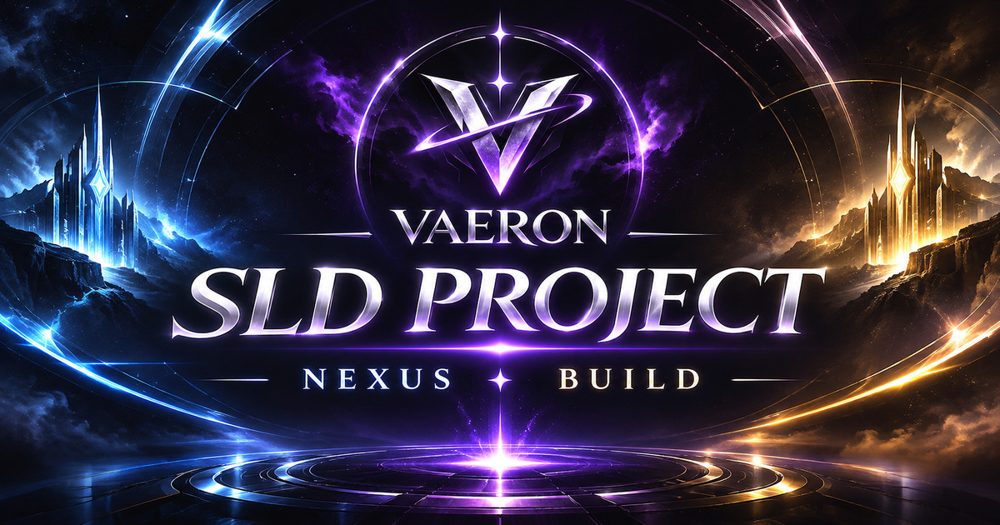

<p align="center">
  
</p>

<h1 align="center">NEXUS</h1>
<p align="center"><strong>개복디 넥서스 · 유닛도감 / 체크리스트 / 빌더</strong></p>
<p align="center"><sub>by VAERON · 현재 버전 NXSBuild-V5</sub></p>

---

## 프로젝트 소개



<sub>출처: VAERON SLD PROJECT 공식 에셋</sub>

**NEXUS**는 게임 유닛 탐색과 조합 관리부터 전투 수치 분석까지 한곳에서 제공하는 통합 웹 도구입니다. 기존 유닛도감·체크리스트와 빌더를 하나의 `index.html`에서 실행하도록 구성했습니다.

- **유닛도감:** 유닛 정보, 종족별 탐색, 검색, 즐겨찾기, 나의 조합, 필요 재료 확인
- **체크리스트:** 목표 유닛과 조합 진행 상태 관리
- **빌더:** 전투 조건·특성·쥬얼 설정, DPS 분석, 프리셋 및 클리어 기록 관련 기능

## 주요 기능

| 구성 | 핵심 내용 |
| --- | --- |
| 유닛도감 | 유닛/카테고리 탐색, 검색, 즐겨찾기, 조합 및 재료 계산 |
| 체크리스트 | 조합 목표 확인 및 진행 상태 체크 |
| 빌더 | 기본/전투 설정, DPS 계산, 특성 및 쥬얼, 프리셋 관리 |
| 독립창 | 넥서스 조합/재료 창과 빌더 분석·특성 유틸 창을 별도로 실행 |
| 글씨 크기 | 공통 헤더에서 표시 크기 조절 |
| 화면 기억 | 마지막 메인 화면을 브라우저 로컬 저장소에 보관 |
| 반응형 | PC·태블릿·모바일 레이아웃 제공 |

### 화면 복원 규칙

브라우저를 닫았다가 다시 열면 마지막 메인 화면을 복원합니다. **체크리스트는 유닛도감의 구성 화면**으로 간주합니다.

| 종료 전 사용 화면 | 다음 접속 시 시작 화면 |
| --- | --- |
| 유닛도감 | 유닛도감 |
| 체크리스트 | 유닛도감 |
| 빌더 | 빌더 |

### 독립창 사용

상단 독립창 메뉴에서 **넥서스 · 필요 재료**, **빌더 - 분석 보드**, **빌더 - 특성 유틸 목록**, **빌더 - 분석 보드 + 특성 유틸**, **넥서스 + 빌더 전체 실행**을 선택할 수 있습니다. **넥서스 + 빌더 전체 실행**은 필요 재료·특성 유틸 관리·분석 보드를 하나의 독립창에 세로로 표시하며, 개별 독립창은 기존과 동일하게 실행할 수 있습니다.

## 기술 및 파일 구성

- **프런트엔드:** HTML, CSS, JavaScript
- **호스팅:** GitHub Pages에 배포 가능한 정적 사이트
- **로컬 데이터:** 브라우저 `localStorage`를 통한 즐겨찾기·화면 선택·설정/프리셋 등의 저장
- **통합 실행:** 하나의 `index.html` 문서에서 유닛도감·체크리스트·빌더를 직접 실행하고 기능별 CSS·이벤트 적용 범위를 분리

```text
/
├── src/                        # 전체 웹 실행 원본 (GitHub 배포 시 내부 파일만 업로드)
│   ├── index.html              # 통합 진입점 · APP_VERSION
│   ├── nexus_app.js
│   ├── nexus_data.js
│   ├── nexus_checklist.js
│   ├── nexus_responsive.js
│   ├── nexus_style.css
│   ├── nexus_checklist.css
│   ├── build_app.js
│   ├── build_calc.js
│   ├── build_data.js
│   ├── build_unit.js
│   ├── build_preset.js
│   ├── build_responsive.js
│   ├── build_style.css
│   ├── build_unit.css
│   ├── build_preset.css
│   ├── asset/                  # 아이콘·로고·파비콘·공유 이미지
│   │   ├── jw/                 # 영문 쥬얼 이미지 25개
│   │   ├── og-image.jpg
│   │   └── vaeron.png
│   └── googlec03dd31e5a5edd69.html
├── deploy/                     # 현재 버전 누적 변경 파일 (src/ 기준 상대 경로)
├── README.md
└── RELEASE_NOTES.md
```

로컬 실행 진입점은 `src/index.html`입니다. deploy/의 웹 변경 파일은 src/ 기준 상대 경로로 GitHub 리포지토리 최상위에 반영합니다. README.md와 RELEASE_NOTES.md는 프로젝트 최상위에서 관리하며 GitHub에도 최상위에 배포합니다. README 이미지 경로는 GitHub 배포 기준(`./asset/`)을 유지하므로 로컬 ZIP의 최상위 README 미리보기에서는 이미지가 표시되지 않을 수 있습니다.

빌더는 `index.html`의 같은 문서에서 직접 실행합니다. 메인 빌더 화면은 공통 헤더 아래 CSS 레이아웃으로 배치하고, 독립창과 통합 독립창도 해당 문서의 실행 모드로 구성합니다. 파일명은 `nexus_`/`build_` 접두어로 구분합니다. 쥬얼 이미지는 `asset/jw/`에 있으며 빌더에서 `./asset/jw/영문파일명.png` 경로로 불러옵니다. `asset/`에는 VAERON SLD PROJECT의 공식 이미지 에셋도 포함되어 있습니다.

## GitHub Pages 배포

1. GitHub의 공개 리포지토리 최상위에 **src/ 내부의 웹 실행 파일과 asset/ 폴더 전체, 최상위 README.md와 RELEASE_NOTES.md**를 업로드합니다. (src/ 자체를 업로드하거나 ZIP의 버전 폴더, deploy/, 개인 백업 파일을 업로드하지 않습니다.)
2. **Settings → Pages**에서 소스를 **Deploy from a branch**, 브랜치는 `main`, 폴더는 `/(root)`로 지정합니다.
3. GitHub Pages에서 제공한 주소로 접속합니다.
4. 배포 시 `index.html`의 Open Graph URL과 공유 이미지 URL이 실제 배포 환경에 맞는지 확인합니다.

쥬얼 이미지 영문화가 아직 반영되지 않은 이전 배포본을 갱신할 때는 `src/asset/jw/`의 영문 PNG 25개와 최신 `build_unit.js`를 함께 배포한 뒤 기존 한글명 PNG를 서버에서 삭제합니다. V5의 deploy/에는 V5 변경 파일만 포함됩니다.

## 버전 및 캐시

최초 공개 버전은 **`NXSBuild-V1`**, 현재 버전은 **`NXSBuild-V5`**입니다. 버전 상수는 원본 `src/index.html` 상단에 있습니다.

```js
window.APP_VERSION = "NXSBuild-V5";
```

공통 버전이 연결된 JS·CSS, 사이트 파비콘, 매니페스트 요청, 쥬얼 이미지는 URL 버전 매개변수를 통해 새 파일을 요청합니다. 매니페스트 **내부** 아이콘과 Google·메신저가 수집하는 Open Graph 이미지는 브라우저의 일반 캐시와 독립된 업데이트 정책이 적용될 수 있으므로, 실제 배포 후 별도 확인해야 합니다.

## 데이터 보관 및 사용 환경

- 계정 로그인 없이 사용할 수 있는 정적 웹 도구입니다.
- 사용자 설정은 기본적으로 **현재 브라우저 저장소에 보관**되며 다른 기기로 자동 동기화되지 않습니다.
- 시크릿 모드 사용이나 브라우저 데이터 삭제 시 일부 저장 내용이 사라질 수 있습니다.
- 독립창·모바일 표시·이미지 로딩은 브라우저 환경에 따라 차이가 날 수 있습니다.

## 제작

<p align="center">
  
</p>

**VAERON** · NEXUS / SLD PROJECT

---

<sub>© VAERON. NEXUS Project.</sub>
